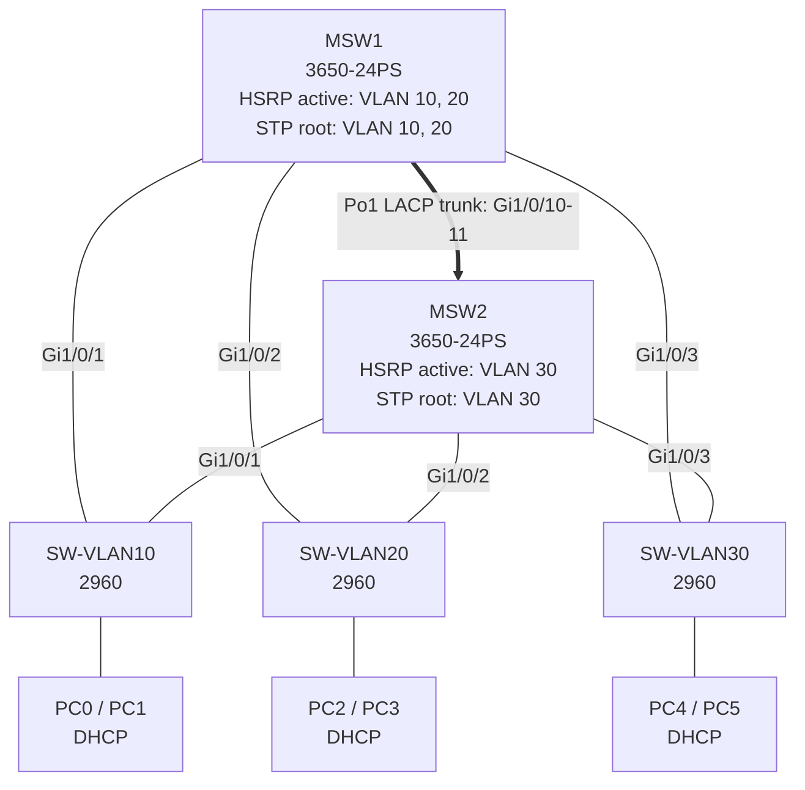

# Multilayer Switch Redundancy with HSRP, EtherChannel, DHCP and STP

## 1. Objective

Build a resilient Cisco Packet Tracer campus LAN with two **Cisco 3650-24PS multilayer switches** and three **Cisco 2960 access switches**.

- [ ] Create VLANs 10, 20, and 30.
- [ ] Enable inter-VLAN routing on both multilayer switches.
- [ ] Provide a redundant default gateway with HSRP.
- [ ] Bundle two MSW-to-MSW links with LACP EtherChannel.
- [ ] Align Rapid-PVST roots with the preferred HSRP active switch.
- [ ] Provide non-overlapping DHCP address ranges from both multilayer switches.
- [ ] Protect PC-facing ports with PortFast and BPDU Guard.
- [ ] Verify normal operation and test every requested failure.

> [!important] Packet Tracer device/interface check
> This guide uses interfaces available on the stated models: `GigabitEthernet1/0/x` on the 3650-24PS, and `GigabitEthernet0/1`, `GigabitEthernet0/2`, plus `FastEthernet0/1` and `FastEthernet0/2` on the 2960. The configurations use fixed 802.1Q trunking, so do **not** add `switchport trunk encapsulation dot1q`; that command is unnecessary and may not exist in Packet Tracer's fixed-encapsulation switch image.

> [!check] Compatibility verification
> The commands were checked against the command references bundled with the locally installed Cisco Packet Tracer 9.0.0. Its 3650 parser includes LACP `mode active`, Layer 2 port-channels, VLAN trunk filtering, Rapid-PVST root selection, HSRP priority/preempt/interface tracking, and IOS DHCP server commands. Its 2960 parser includes the stated FastEthernet/GigabitEthernet ports, Rapid-PVST, trunk/access mode, PortFast, and BPDU Guard.

> [!caution] Classroom addressing
> The `200.100.x.0/24` networks are retained exactly as supplied. They are public IPv4 address space, not RFC 1918 private addresses. Use them only inside this isolated lab.

## 2. Network Topology Image

![[Screenshot 2026-09-29 094913.png]]



## 3. Physical Connection Table

Use **Copper Straight-Through** or Packet Tracer's **Automatically Choose Connection Type** option.

| Link | Device A interface | Device B interface | Purpose |
|---|---|---|---|
| 1 | MSW1 `Gi1/0/10` | MSW2 `Gi1/0/10` | LACP EtherChannel member 1 |
| 2 | MSW1 `Gi1/0/11` | MSW2 `Gi1/0/11` | LACP EtherChannel member 2 |
| 3 | SW-VLAN10 `Gi0/1` | MSW1 `Gi1/0/1` | VLAN 10 trunk uplink |
| 4 | SW-VLAN10 `Gi0/2` | MSW2 `Gi1/0/1` | VLAN 10 redundant trunk uplink |
| 5 | SW-VLAN20 `Gi0/1` | MSW1 `Gi1/0/2` | VLAN 20 trunk uplink |
| 6 | SW-VLAN20 `Gi0/2` | MSW2 `Gi1/0/2` | VLAN 20 redundant trunk uplink |
| 7 | SW-VLAN30 `Gi0/1` | MSW1 `Gi1/0/3` | VLAN 30 trunk uplink |
| 8 | SW-VLAN30 `Gi0/2` | MSW2 `Gi1/0/3` | VLAN 30 redundant trunk uplink |
| 9 | PC0 `Fa0` | SW-VLAN10 `Fa0/1` | VLAN 10 client |
| 10 | PC1 `Fa0` | SW-VLAN10 `Fa0/2` | VLAN 10 client |
| 11 | PC2 `Fa0` | SW-VLAN20 `Fa0/1` | VLAN 20 client |
| 12 | PC3 `Fa0` | SW-VLAN20 `Fa0/2` | VLAN 20 client |
| 13 | PC4 `Fa0` | SW-VLAN30 `Fa0/1` | VLAN 30 client |
| 14 | PC5 `Fa0` | SW-VLAN30 `Fa0/2` | VLAN 30 client |

> [!check] Before configuration
> Confirm the cables are connected to these exact ports. On each switch, run `show ip interface brief` after the links turn green.

## 4. VLAN and IP Addressing Table

| VLAN | Name | Network/mask | HSRP group | HSRP VIP/default gateway | MSW1 SVI | MSW2 SVI | Preferred active/root |
|---:|---|---|---:|---|---|---|---|
| 10 | USERS_VLAN10 | `200.100.10.0/24` | 10 | `200.100.10.1` | `200.100.10.2` | `200.100.10.3` | MSW1 |
| 20 | USERS_VLAN20 | `200.100.20.0/24` | 20 | `200.100.20.1` | `200.100.20.2` | `200.100.20.3` | MSW1 |
| 30 | USERS_VLAN30 | `200.100.30.0/24` | 30 | `200.100.30.1` | `200.100.30.2` | `200.100.30.3` | MSW2 |

### DHCP split-scope plan

| DHCP server | Usable range in every VLAN | Example for VLAN 10 | Exclusions in every `/24` |
|---|---|---|---|
| MSW1 | `.10` through `.127` | `200.100.10.10-200.100.10.127` | `.1-.9` and `.128-.254` |
| MSW2 | `.128` through `.253` | `200.100.10.128-200.100.10.253` | `.1-.127` and `.254` |

The `.1` HSRP VIP, `.2` MSW1 SVI, `.3` MSW2 SVI, and reserved addresses `.4-.9` are never leased. Both DHCP servers may answer a client broadcast, but their lease ranges cannot overlap.

> [!note] No DHCP relay is required
> Each DHCP server owns an SVI in the same VLAN as the clients. Therefore, do not configure `ip helper-address` in this topology.

## 5. Redundancy Design

| Function                  | VLAN 10              | VLAN 20              | VLAN 30              |
| ------------------------- | -------------------- | -------------------- | -------------------- |
| HSRP active               | MSW1, priority `110` | MSW1, priority `110` | MSW2, priority `110` |
| HSRP standby              | MSW2, priority `100` | MSW2, priority `100` | MSW1, priority `100` |
| Rapid-PVST root primary   | MSW1                 | MSW1                 | MSW2                 |
| Rapid-PVST root secondary | MSW2                 | MSW2                 | MSW1                 |
| Tracked local uplink      | `Gi1/0/1`            | `Gi1/0/2`            | `Gi1/0/3`            |

- `preempt` lets the preferred multilayer switch reclaim the active HSRP role after recovery.
- A tracked direct access-switch uplink subtracts `20` from the local HSRP priority when it fails.
- The active priority falls from `110` to `90`, allowing the peer at priority `100` to become active.
- STP root placement follows the HSRP active switch so client traffic normally uses the shortest path.
- Port-channel 1 carries VLANs 10, 20, and 30 between MSW1 and MSW2.
- DHCP is active-active split scope, not stateful lease synchronization. Each server owns a different half of every subnet.

> [!warning] Configure in this order
> 1. Cable the topology.  
> 2. Configure MSW1.  
> 3. Configure MSW2.  
> 4. Configure all three access switches.  
> 5. Wait for STP/HSRP to converge.  
> 6. Set the PCs to DHCP.  
> 7. Verify before performing failure tests.

## 6. MSW1 Full Configuration

Paste the entire block into **MSW1**.

```cisco
enable
configure terminal
hostname MSW1
no ip domain-lookup
ip routing
spanning-tree mode rapid-pvst

vlan 10
 name USERS_VLAN10
exit
vlan 20
 name USERS_VLAN20
exit
vlan 30
 name USERS_VLAN30
exit

interface GigabitEthernet1/0/1
 description TRUNK_TO_SW-VLAN10_Gi0/1
 switchport mode trunk
 switchport trunk allowed vlan 10
 no shutdown
exit

interface GigabitEthernet1/0/2
 description TRUNK_TO_SW-VLAN20_Gi0/1
 switchport mode trunk
 switchport trunk allowed vlan 20
 no shutdown
exit

interface GigabitEthernet1/0/3
 description TRUNK_TO_SW-VLAN30_Gi0/1
 switchport mode trunk
 switchport trunk allowed vlan 30
 no shutdown
exit

interface range GigabitEthernet1/0/10 - 11
 description LACP_MEMBERS_TO_MSW2
 switchport mode trunk
 switchport trunk allowed vlan 10,20,30
 channel-group 1 mode active
 no shutdown
exit

interface Port-channel1
 description LACP_TRUNK_TO_MSW2
 switchport mode trunk
 switchport trunk allowed vlan 10,20,30
 no shutdown
exit

interface Vlan10
 description VLAN10_HSRP_GATEWAY
 ip address 200.100.10.2 255.255.255.0
 standby 10 ip 200.100.10.1
 standby 10 priority 110
 standby 10 preempt
 standby 10 track GigabitEthernet1/0/1 20
 no shutdown
exit

interface Vlan20
 description VLAN20_HSRP_GATEWAY
 ip address 200.100.20.2 255.255.255.0
 standby 20 ip 200.100.20.1
 standby 20 priority 110
 standby 20 preempt
 standby 20 track GigabitEthernet1/0/2 20
 no shutdown
exit

interface Vlan30
 description VLAN30_HSRP_GATEWAY
 ip address 200.100.30.2 255.255.255.0
 standby 30 ip 200.100.30.1
 standby 30 priority 100
 standby 30 preempt
 standby 30 track GigabitEthernet1/0/3 20
 no shutdown
exit

spanning-tree vlan 10,20 root primary
spanning-tree vlan 30 root secondary

ip dhcp excluded-address 200.100.10.1 200.100.10.9
ip dhcp excluded-address 200.100.10.128 200.100.10.254
ip dhcp excluded-address 200.100.20.1 200.100.20.9
ip dhcp excluded-address 200.100.20.128 200.100.20.254
ip dhcp excluded-address 200.100.30.1 200.100.30.9
ip dhcp excluded-address 200.100.30.128 200.100.30.254

ip dhcp pool VLAN10-MSW1
 network 200.100.10.0 255.255.255.0
 default-router 200.100.10.1
 dns-server 8.8.8.8
exit

ip dhcp pool VLAN20-MSW1
 network 200.100.20.0 255.255.255.0
 default-router 200.100.20.1
 dns-server 8.8.8.8
exit

ip dhcp pool VLAN30-MSW1
 network 200.100.30.0 255.255.255.0
 default-router 200.100.30.1
 dns-server 8.8.8.8
exit

end
write memory
```

> [!check] MSW1 target state
> VLANs 10 and 20 should become HSRP **Active** and STP **root**. VLAN 30 should become HSRP **Standby** and STP **root secondary**.

## 7. MSW2 Full Configuration

Paste the entire block into **MSW2**.

```cisco
enable
configure terminal
hostname MSW2
no ip domain-lookup
ip routing
spanning-tree mode rapid-pvst

vlan 10
 name USERS_VLAN10
exit
vlan 20
 name USERS_VLAN20
exit
vlan 30
 name USERS_VLAN30
exit 

interface GigabitEthernet1/0/1
 description TRUNK_TO_SW-VLAN10_Gi0/2
 switchport mode trunk
 switchport trunk allowed vlan 10
 no shutdown
exit

interface GigabitEthernet1/0/2
 description TRUNK_TO_SW-VLAN20_Gi0/2
 switchport mode trunk
 switchport trunk allowed vlan 20
 no shutdown
exit

interface GigabitEthernet1/0/3
 description TRUNK_TO_SW-VLAN30_Gi0/2
 switchport mode trunk
 switchport trunk allowed vlan 30
 no shutdown
exit

interface range GigabitEthernet1/0/10 - 11
 description LACP_MEMBERS_TO_MSW1
 switchport mode trunk
 switchport trunk allowed vlan 10,20,30
 channel-group 1 mode active
 no shutdown
exit

interface Port-channel1
 description LACP_TRUNK_TO_MSW1
 switchport mode trunk
 switchport trunk allowed vlan 10,20,30
 no shutdown
exit

interface Vlan10
 description VLAN10_HSRP_GATEWAY
 ip address 200.100.10.3 255.255.255.0
 standby 10 ip 200.100.10.1
 standby 10 priority 100
 standby 10 preempt
 standby 10 track GigabitEthernet1/0/1 20
 no shutdown
exit

interface Vlan20
 description VLAN20_HSRP_GATEWAY
 ip address 200.100.20.3 255.255.255.0
 standby 20 ip 200.100.20.1
 standby 20 priority 100
 standby 20 preempt
 standby 20 track GigabitEthernet1/0/2 20
 no shutdown
exit

interface Vlan30
 description VLAN30_HSRP_GATEWAY
 ip address 200.100.30.3 255.255.255.0
 standby 30 ip 200.100.30.1
 standby 30 priority 110
 standby 30 preempt
 standby 30 track GigabitEthernet1/0/3 20
 no shutdown
exit

spanning-tree vlan 10,20 root secondary
spanning-tree vlan 30 root primary

ip dhcp excluded-address 200.100.10.1 200.100.10.127
ip dhcp excluded-address 200.100.10.254
ip dhcp excluded-address 200.100.20.1 200.100.20.127
ip dhcp excluded-address 200.100.20.254
ip dhcp excluded-address 200.100.30.1 200.100.30.127
ip dhcp excluded-address 200.100.30.254

ip dhcp pool VLAN10-MSW2
 network 200.100.10.0 255.255.255.0
 default-router 200.100.10.1
 dns-server 8.8.8.8
exit

ip dhcp pool VLAN20-MSW2
 network 200.100.20.0 255.255.255.0
 default-router 200.100.20.1
 dns-server 8.8.8.8
exit

ip dhcp pool VLAN30-MSW2
 network 200.100.30.0 255.255.255.0
 default-router 200.100.30.1
 dns-server 8.8.8.8
exit

end
write memory
```

> [!check] MSW2 target state
> VLANs 10 and 20 should become HSRP **Standby** and STP **root secondary**. VLAN 30 should become HSRP **Active** and STP **root**.

## 8. SW-VLAN10 Full Configuration

Paste the entire block into **SW-VLAN10**.

```cisco
enable
configure terminal
hostname SW-VLAN10
no ip domain-lookup
spanning-tree mode rapid-pvst

vlan 10
 name USERS_VLAN10
exit

interface GigabitEthernet0/1
 description TRUNK_TO_MSW1_Gi1/0/1
 switchport mode trunk
 switchport trunk allowed vlan 10
 no shutdown
exit

interface GigabitEthernet0/2
 description TRUNK_TO_MSW2_Gi1/0/1
 switchport mode trunk
 switchport trunk allowed vlan 10
 no shutdown
exit

interface range FastEthernet0/1 - 10
 description VLAN10_PC_PORTS
 switchport mode access
 switchport access vlan 10
 spanning-tree portfast
 spanning-tree bpduguard enable
 no shutdown
exit

end
write memory
```

> [!warning] PortFast boundary
> PortFast and BPDU Guard are configured only on `Fa0/1-2`. Never add them to `Gi0/1-2`, because those ports connect to switches and must participate in STP.

## 9. SW-VLAN20 Full Configuration

Paste the entire block into **SW-VLAN20**.

```cisco
enable
configure terminal
hostname SW-VLAN20
no ip domain-lookup
spanning-tree mode rapid-pvst

vlan 20
 name USERS_VLAN20
exit

interface GigabitEthernet0/1
 description TRUNK_TO_MSW1_Gi1/0/2
 switchport mode trunk
 switchport trunk allowed vlan 20
 no shutdown
exit

interface GigabitEthernet0/2
 description TRUNK_TO_MSW2_Gi1/0/2
 switchport mode trunk
 switchport trunk allowed vlan 20
 no shutdown
exit

interface range FastEthernet0/1 - 2
 description VLAN20_PC_PORTS
 switchport mode access
 switchport access vlan 20
 spanning-tree portfast
 spanning-tree bpduguard enable
 no shutdown
exit

end
write memory
```

## 10. SW-VLAN30 Full Configuration

Paste the entire block into **SW-VLAN30**.

```cisco
enable
configure terminal
hostname SW-VLAN30
no ip domain-lookup
spanning-tree mode rapid-pvst

vlan 30
 name USERS_VLAN30
exit

interface GigabitEthernet0/1
 description TRUNK_TO_MSW1_Gi1/0/3
 switchport mode trunk
 switchport trunk allowed vlan 30
 no shutdown
exit

interface GigabitEthernet0/2
 description TRUNK_TO_MSW2_Gi1/0/3
 switchport mode trunk
 switchport trunk allowed vlan 30
 no shutdown
exit

interface range FastEthernet0/1 - 2
 description VLAN30_PC_PORTS
 switchport mode access
 switchport access vlan 30
 spanning-tree portfast
 spanning-tree bpduguard enable
 no shutdown
exit

end
write memory
```

## 11. PC DHCP Configuration

Repeat these steps on **PC0 through PC5**:

1. Select the PC.
2. Open **Desktop**.
3. Open **IP Configuration**.
4. Select **DHCP**.
5. Wait for the address, mask, gateway, and DNS server to appear.

Expected client settings:

| PCs | VLAN | Expected address | Mask | Gateway | DNS |
|---|---:|---|---|---|---|
| PC0, PC1 | 10 | `200.100.10.10-127` or `200.100.10.128-253` | `255.255.255.0` | `200.100.10.1` | `8.8.8.8` |
| PC2, PC3 | 20 | `200.100.20.10-127` or `200.100.20.128-253` | `255.255.255.0` | `200.100.20.1` | `8.8.8.8` |
| PC4, PC5 | 30 | `200.100.30.10-127` or `200.100.30.128-253` | `255.255.255.0` | `200.100.30.1` | `8.8.8.8` |

> [!tip] Which server answered?
> An address ending in `.10-.127` came from MSW1. An address ending in `.128-.253` came from MSW2. Either result is correct.

## 12. Verification Commands

Run the commands in privileged EXEC mode (`MSW1#`, `MSW2#`, or `SW-VLAN10#`).

### On both multilayer switches

```cisco
show vlan brief
show interfaces trunk
show etherchannel summary
show interfaces port-channel 1
show standby brief
show spanning-tree
show spanning-tree vlan 10
show spanning-tree vlan 20
show spanning-tree vlan 30
show ip interface brief
show ip route
show ip dhcp binding
show ip dhcp pool
show running-config
```

### On each access switch

```cisco
show vlan brief
show interfaces trunk
show spanning-tree
show spanning-tree vlan 10
show spanning-tree vlan 20
show spanning-tree vlan 30
show ip interface brief
show interfaces status
```

Use only the `show spanning-tree vlan` command matching that access switch's VLAN; commands for VLANs not created locally will return no instance.

### Minimum acceptance checklist

- [ ] `show interfaces trunk` lists the expected allowed VLANs.
- [ ] `show etherchannel summary` shows `Po1(SU)` and both member ports marked `(P)`.
- [ ] `show standby brief` shows MSW1 active for VLANs 10/20 and MSW2 active for VLAN 30.
- [ ] MSW1 reports itself as STP root for VLANs 10/20.
- [ ] MSW2 reports itself as STP root for VLAN 30.
- [ ] `show ip interface brief` shows `Vlan10`, `Vlan20`, and `Vlan30` as `up/up` on both MSWs.
- [ ] `show ip route` contains connected routes for all three `/24` networks.
- [ ] Every PC receives DHCP settings and can ping its HSRP VIP.
- [ ] PCs can ping clients in the other VLANs.

## 13. HSRP Testing

### Confirm the normal roles

On both MSWs:

```cisco
show standby brief
show standby
```

Expected normal state:

| VLAN | MSW1 | MSW2 | Virtual IP |
|---:|---|---|---|
| 10 | Active, priority 110 | Standby, priority 100 | `200.100.10.1` |
| 20 | Active, priority 110 | Standby, priority 100 | `200.100.20.1` |
| 30 | Standby, priority 100 | Active, priority 110 | `200.100.30.1` |

From one PC in each VLAN:

```text
ping 200.100.10.1
ping 200.100.20.1
ping 200.100.30.1
```

> [!note] First ping behavior
> One initial timeout can occur while ARP, STP, or HSRP information settles. Repeat the ping before treating it as a fault.

## 14. EtherChannel Testing

On MSW1 and MSW2:

```cisco
show etherchannel summary
show interfaces port-channel 1
show interfaces trunk
show lacp neighbor
```

Healthy summary indicators:

- `Po1(SU)` means a Layer 2 port-channel is in use.
- `Gi1/0/10(P)` and `Gi1/0/11(P)` mean both links are bundled.
- Port-channel 1 must be a trunk allowing VLANs `10,20,30`.

If a member is not bundled, compare both ends:

```cisco
show running-config interface GigabitEthernet1/0/10
show running-config interface GigabitEthernet1/0/11
show running-config interface Port-channel1
```

## 15. STP Testing

On MSW1:

```cisco
show spanning-tree vlan 10
show spanning-tree vlan 20
show spanning-tree vlan 30
```

On MSW2, run the same commands.

Expected roots:

| VLAN | Root bridge | Expected access-switch forwarding uplink | Expected alternate uplink |
|---:|---|---|---|
| 10 | MSW1 | SW-VLAN10 `Gi0/1` toward MSW1 | SW-VLAN10 `Gi0/2` toward MSW2 |
| 20 | MSW1 | SW-VLAN20 `Gi0/1` toward MSW1 | SW-VLAN20 `Gi0/2` toward MSW2 |
| 30 | MSW2 | SW-VLAN30 `Gi0/2` toward MSW2 | SW-VLAN30 `Gi0/1` toward MSW1 |

On each access switch, verify its local VLAN:

```cisco
show spanning-tree vlan 10
show spanning-tree vlan 20
show spanning-tree vlan 30
```

Only run the command for the VLAN present on that switch. Look for one `Root FWD` uplink and one `Altn BLK` uplink during normal operation.

## 16. DHCP Testing

### Check both DHCP servers

On MSW1 and MSW2:

```cisco
show ip dhcp pool
show ip dhcp binding
show ip dhcp conflict
```

Verify:

- [ ] MSW1 leases only `.10-.127` in each VLAN.
- [ ] MSW2 leases only `.128-.253` in each VLAN.
- [ ] No client receives `.1`, `.2`, `.3`, `.4-.9`, or `.254`.
- [ ] Every client uses the `.1` HSRP VIP as its default gateway.
- [ ] Every client uses `8.8.8.8` as DNS.
- [ ] `show ip dhcp conflict` is empty.

### Renew a client lease

On a PC, open **Desktop > Command Prompt**:

```text
ipconfig /release
ipconfig /renew
ipconfig /all
```

If the Packet Tracer PC image does not accept release/renew, open **Desktop > IP Configuration**, select **Static**, and then select **DHCP** again.

## 17. Failure/Redundancy Tests

Run a continuous ping from a PC before each test. Packet Tracer may not support an unlimited ping, so repeat normal pings while changing the link state.

> [!warning] Restore after every test
> Reconnect or power on the failed item, wait for convergence, and confirm the normal HSRP/STP roles before starting the next test.

| Test | Action | Expected behavior | Verification |
|---:|---|---|---|
| 1 | Disconnect **MSW1 `Gi1/0/1` ↔ SW-VLAN10 `Gi0/1`** | MSW1's VLAN 10 HSRP priority drops from 110 to 90 because the tracked uplink is down. MSW2 becomes VLAN 10 active at priority 100. SW-VLAN10 forwards through `Gi0/2`. A few pings may time out during convergence. | `show standby brief`; `show spanning-tree vlan 10`; ping `200.100.10.1` and a remote-VLAN PC. |
| 2 | Disconnect **MSW2 `Gi1/0/3` ↔ SW-VLAN30 `Gi0/2`** | MSW2's VLAN 30 HSRP priority drops from 110 to 90. MSW1 becomes VLAN 30 active at priority 100. SW-VLAN30 forwards through `Gi0/1`. | `show standby brief`; `show spanning-tree vlan 30`; ping `200.100.30.1` and a remote-VLAN PC. |
| 3 | Disconnect one EtherChannel member, for example `Gi1/0/10` | Port-channel 1 remains up and carries all traffic over `Gi1/0/11`. HSRP and STP roles should not change. | `show etherchannel summary` shows one `(P)` member; `show interfaces port-channel 1`; end-to-end ping stays successful. |
| 4 | Disconnect both EtherChannel members `Gi1/0/10-11` | Port-channel 1 goes down. The MSWs can still share each VLAN through the dual-homed access switch for that VLAN, so HSRP and inter-VLAN traffic should continue after STP reconverges. The direct core-to-core bundled path is unavailable. | `show etherchannel summary`; `show spanning-tree vlan 10`; `show standby brief`; ping between all VLANs. |
| 5 | Power off MSW1 | MSW2 becomes HSRP active for VLANs 10, 20, and 30. MSW2 becomes the surviving STP root for all three VLANs. Existing DHCP clients keep their leases and use the same `.1` gateways; new leases can come only from MSW2's `.128-.253` ranges. | On MSW2: `show standby brief`, `show spanning-tree`, `show ip dhcp binding`; test all PC pings and renew one lease. |
| 6 | Power off MSW2 | MSW1 becomes HSRP active for VLANs 10, 20, and 30. MSW1 becomes the surviving STP root for all three VLANs. Existing clients keep working; new leases can come only from MSW1's `.10-.127` ranges. | On MSW1: `show standby brief`, `show spanning-tree`, `show ip dhcp binding`; test all PC pings and renew one lease. |

### Optional CLI method for a single-link test

Instead of removing a cable, shut the relevant interface on the MSW:

```cisco
enable
configure terminal
interface GigabitEthernet1/0/1
shutdown
end
```

Restore it after the test:

```cisco
configure terminal
interface GigabitEthernet1/0/1
no shutdown
end
```

Adjust the interface number to match the test. Do not save the shutdown state.

## 18. Troubleshooting Commands

### VLAN or trunk problem

```cisco
show vlan brief
show interfaces trunk
show interfaces switchport
show interfaces status
show mac address-table dynamic
```

Check that each access-switch uplink carries only its required VLAN and Port-channel 1 carries VLANs 10, 20, and 30.

### EtherChannel problem

```cisco
show etherchannel summary
show etherchannel port-channel
show interfaces port-channel 1
show lacp neighbor
show running-config interface GigabitEthernet1/0/10
show running-config interface GigabitEthernet1/0/11
show running-config interface Port-channel1
```

Both ends must use the same channel number, LACP mode, trunk mode, and allowed VLAN list.

### HSRP problem

```cisco
show standby brief
show standby
show ip interface brief
show running-config interface Vlan10
show running-config interface Vlan20
show running-config interface Vlan30
```

Check the group number, VIP, priority, preempt setting, SVI state, and tracked physical interface.

### STP problem

```cisco
show spanning-tree summary
show spanning-tree root
show spanning-tree vlan 10
show spanning-tree vlan 20
show spanning-tree vlan 30
show spanning-tree inconsistentports
```

Do not enable PortFast or BPDU Guard on any switch-to-switch uplink.

### DHCP problem

```cisco
show ip dhcp pool
show ip dhcp binding
show ip dhcp conflict
show running-config | section dhcp
show ip interface brief
```

Check that the client VLAN SVI is `up/up`, the PC port is in the correct access VLAN, and the two servers' exclusions produce different lease ranges.

### Routing and reachability problem

```cisco
show ip route
show ip interface brief
show arp
ping 200.100.10.1
ping 200.100.20.1
ping 200.100.30.1
```

All three networks should appear as directly connected on both multilayer switches because both switches have an SVI in every VLAN.

## 19. Expected Results

### Final success checklist

- [ ] The topology is cabled exactly as shown in the physical connection table.
- [ ] All switch-to-switch links are trunks; PC links are access ports.
- [ ] Port-channel 1 is a working LACP Layer 2 EtherChannel with two bundled members.
- [ ] VLANs 10, 20, and 30 cross Port-channel 1.
- [ ] MSW1 is HSRP active for VLANs 10 and 20.
- [ ] MSW2 is HSRP active for VLAN 30.
- [ ] Every VLAN uses `.1` as the default gateway.
- [ ] MSW1 is Rapid-PVST root for VLANs 10 and 20.
- [ ] MSW2 is Rapid-PVST root for VLAN 30.
- [ ] Each access switch has one forwarding uplink and one alternate/blocking uplink in normal operation.
- [ ] MSW1 DHCP leases use `.10-.127` only.
- [ ] MSW2 DHCP leases use `.128-.253` only.
- [ ] All PCs receive the correct `/24` address, `.1` gateway, and `8.8.8.8` DNS.
- [ ] Same-VLAN and inter-VLAN pings succeed.
- [ ] One EtherChannel member can fail without taking Port-channel 1 down.
- [ ] Direct VLAN uplink failures trigger the intended HSRP takeover through interface tracking.
- [ ] Powering off either multilayer switch leaves all VLANs reachable through the surviving switch.

> [!success] Lab complete
> The finished design provides gateway redundancy, Layer 2 loop prevention, an aggregated core link, split-scope DHCP service, and tested failover for all three VLANs.
